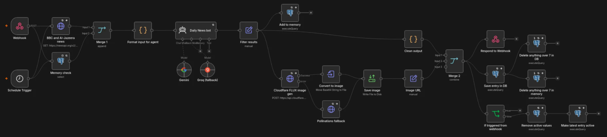
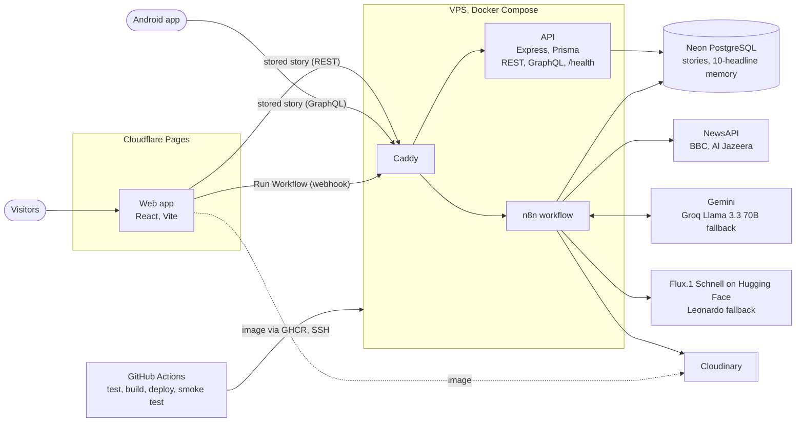

# Agentic News-to-Image

[](https://github.com/jonorl/agentic-ai-news-to-image/actions/workflows/test.yml)
[](https://github.com/jonorl/agentic-ai-news-to-image/actions/workflows/deploy.yml)
[](https://github.com/jonorl/agentic-ai-news-to-image/security/code-scanning)
[](https://api.jonathan-orlowski.dev/health)
[](LICENSE)

An n8n agent that reads the day's news, picks the headline that matters most, and turns it into an image. An LLM chooses one headline from BBC News and Al Jazeera, avoiding anything too close to its last ten picks, and writes a short visual description that Flux.1 Schnell renders. The result is published to a web page and an Android app. Try it at **https://jonathan-orlowski.dev/agentic-ai-news-to-image/**.

<p align="center">
  <a href="https://jonathan-orlowski.dev/agentic-ai-news-to-image/">
    
  </a>
</p>

## Architecture



- **The agent runs on a schedule and on demand.** A scheduled run replaces the story everyone sees. "Run Workflow" on the page runs the same pipeline through a webhook and returns the result to that visitor only.
- **It doesn't repeat itself.** The last ten headlines it chose are kept in Postgres and sent to the model with the new ones, with instructions to skip anything about the same event, person or topic.
- **Each model has a fallback.** Groq takes over if Gemini fails, and Leonardo if Flux.1 fails.
- **A deploy only counts once it's live.** GitHub Actions runs the tests, ships the image, then waits until `/health` reports the new commit and both read APIs return the active story.

## Pipeline

1. **Trigger:** the schedule, or the webhook behind "Run Workflow".
2. **Collect:** fetch the latest headlines from NewsAPI and the ten-headline memory from Postgres, and format them for the agent.
3. **Select:** the agent returns one headline and a visual description of at most 20 words, as JSON.
4. **Remember:** add the headline to the memory and drop anything beyond the last ten.
5. **Render:** Flux.1 Schnell generates the image through the Hugging Face Inference API.
6. **Store:** upload the image to Cloudinary, save the story to Postgres and keep the last seven.
7. **Publish:** a scheduled run marks the new story active; a webhook run returns it as JSON instead.

<details>
<summary>The agent's prompt</summary>

```
#ROLE
You are an editorial selector for a news-to-art website.

#TASK
Choose ONE impactful, globally relevant news headline from the list below.

#SELECTION CRITERIA
1. Pick the most impactful and globally relevant headline
2. Avoid headlines substantially similar to previously selected ones
3. "Substantially similar" means same event, person, or topic
4. If all headlines are similar, choose the least similar option

#OUTPUT FORMAT (STRICT)
Return ONLY a valid JSON object:
{
  "headline": "exact headline text from the numbered list",
  "description": "short visual description, max 20 words, concrete imagery"
}
```

</details>

## API

Served at `https://api.jonathan-orlowski.dev`.

| Endpoint | Used by | Returns |
| --- | --- | --- |
| `POST /api/v1/news` | Web app | `{ "getActiveNews": { id, headline, description, image_url } }` |
| `POST /api/v1/graphql` | Android app | `activeNews { id headline description image_url }` |
| `GET /health` | Deploy smoke test, status badge | `{ "status", "database", "version" }`, with 503 if Postgres is unreachable |

`version` is the commit the image was built from. The database check is cached for five seconds. The container has no Docker `HEALTHCHECK`, because polling the database would keep the Neon free tier from ever suspending.

## Project structure

```
├── backend/                # API (Express, Prisma 7 with the pg driver adapter, graphql-http)
│   ├── src/
│   │   ├── routes/         # REST, GraphQL and /health
│   │   ├── middleware/     # CORS
│   │   └── graphql/        # Schema and resolvers
│   └── test/               # Jest + supertest, with the database mocked
├── frontend/               # Web app (React 19, Vite, Tailwind CSS 4)
│   ├── src/
│   └── public/
│       ├── _headers        # Cloudflare Pages security headers (CSP)
│       └── gtag-init.js    # Google Analytics bootstrap
├── mobile/                 # Android app (React Native, Expo 54); the APK is under Releases
├── shared/                 # Types, copy and fetch logic used by both apps
├── my-workflow.json        # n8n workflow export
└── Dockerfile              # API image
```

## Running locally

Requires Node 22.

```bash
# API: needs AGENTIC_AI_DB_URL in backend/.env
cd backend
npm ci
npx prisma generate
npm run dev                 # http://localhost:3001

# Web app: reads VITE_BACKEND and VITE_WEBHOOK from .env.development
cd frontend
npm ci
npm run dev
```

To run the workflow yourself, import `my-workflow.json` into n8n and add credentials for NewsAPI, Gemini, Groq, Hugging Face, Leonardo, Cloudinary and Postgres.

## Testing

Both apps use Jest.

```bash
cd backend && npm run typecheck && npm test
cd frontend && npm run typecheck && npm run lint && npm test
```

- **API:** the REST and GraphQL responses each app depends on, the `/health` statuses and cache, and which origins CORS allows.
- **Web app:** loading the stored story, running the workflow, and showing an error when the API is down, with `fetch` stubbed.

The `Test` workflow runs both on every push and pull request, and `Build and Deploy` runs it again before shipping.

## Security and maintenance

- **Content Security Policy:** the web app allows scripts only from itself, Google Tag Manager and Cloudflare Web Analytics, images only from Cloudinary, and connections only to the API, the n8n webhook and analytics. Google Analytics is bootstrapped from a file so that no inline script is needed.
- **CORS:** the API answers browsers only on `jonathan-orlowski.dev` and `agentic-ai-news-to-image.pages.dev`, and returns no stack traces.
- **Branch protection:** `main` takes changes through pull requests, which need the `backend` and `frontend` checks to pass and no high-severity CodeQL alerts.
- **CodeQL** scans the TypeScript and the workflows.
- **Dependabot** opens weekly grouped updates for the API, the web app and the Docker base image, and monthly ones for GitHub Actions. The Expo app gets security updates only, since Expo pins its packages to the SDK.

## Limitations

- A live run takes 30 to 60 seconds on free tiers, mostly image generation.
- NewsAPI's free plan limits daily requests, so "Run Workflow" may fail once the day's quota is spent.
- The first request after a quiet spell is slower while Neon wakes up.

## Acknowledgements

n8n for the workflow engine, Black Forest Labs for Flux.1, Hugging Face for hosting it, and NewsAPI for the headlines.

## Contact

Developed by [Jonathan Orlowski](https://jonathan-orlowski.dev/). Licensed under the Apache License 2.0, see [`LICENSE`](LICENSE).
